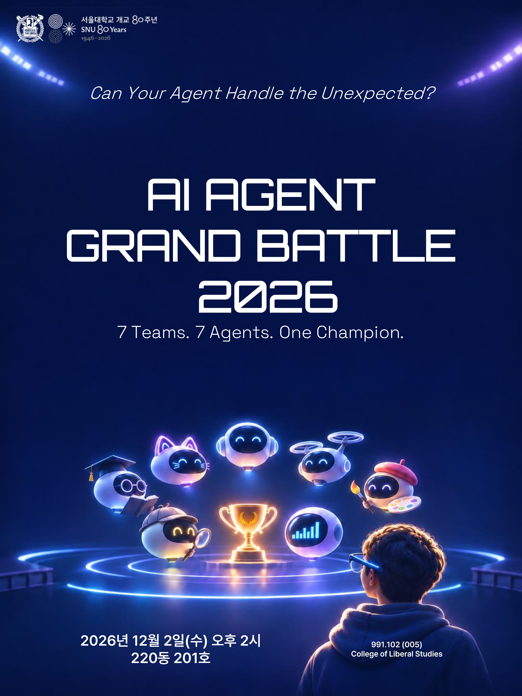

[English](README.md) | 한국어

<div align="center">

# AI AGENT GRAND BATTLE 2026

### Can Your Agent Handle the Unexpected?

7 Teams. 7 Agents. One Champion.

서울대학교 주제탐구세미나2

2026년 12월 2일 수요일 오후 2시 | 220동 201호

[룰북](docs/RULEBOOK.KR.md) | [설치 및 실행](docs/SETUP.KR.md) | [에이전트 구조](docs/ARCHITECTURE.KR.md) | [제출 안내](docs/SUBMISSION.KR.md) | [리더보드](leaderboard/README.KR.md)



</div>

## 대회 소개

AI Agent Grand Battle은 텍스트로 주어진 목표를 이해하고 도구를 사용해 문제를 해결하는 에이전트 대회입니다. 참가팀은 로컬 모델로 상황을 판단하고, 필요한 작업을 실행하며, 그 결과를 확인하는 시스템을 개발합니다.

처음 보는 문제에 대응하는 판단력과 여러 도구를 연결해 목표를 완수하는 능력을 겨룹니다.

## 일정

| 구분 | 일시 | 내용 |
|---|---|---|
| 코드 제출 | 11월 25일 수요일 자정 | 팀별 에이전트 코드 제출 |
| 미션 수행 | 11월 30일 월요일까지 | 연구실 방문 후 제출 코드 실행 |
| 결과 발표 | 12월 2일 수요일 오후 2시 | 220동 201호, 팀별 10분 발표 |

모든 일정은 한국시간을 기준으로 합니다.

## 주요 규정

- 로컬 모델만 사용할 수 있습니다. ChatGPT, Claude, Gemini 등 온라인 모델 API는 사용할 수 없습니다.
- 공통 제공 모델은 Qwen3.8-27B입니다. 제공 모델보다 큰 모델은 사용할 수 없습니다.
- MoE 모델의 크기는 활성 파라미터가 아닌 전체 파라미터 수로 판단합니다.
- RAG와 로컬 데이터는 사용할 수 없습니다.
- 웹 검색으로 외부 AI가 생성한 답변을 가져오는 방식은 사용할 수 없습니다.
- 해결한 문제 수가 많은 팀이 우승하며, 동률이면 수행 시간이 짧은 팀이 우승합니다.

자세한 규정은 [룰북](docs/RULEBOOK.KR.md)을 확인하세요.

## 빠른 시작

Python 3.10 이상과 Ollama를 준비한 뒤 실행합니다.

```bash
git clone https://github.com/101beee/ai-agent-grand-battle-2026.git
cd ai-agent-grand-battle-2026
python3 -m venv .venv
source .venv/bin/activate
python -m pip install -r requirements.txt
ollama pull qwen3-vl:2b-instruct
python agents/tool_agent/main.py --tools
python agents/tool_agent/main.py "위키백과에서 서울대학교를 찾아 두 문장으로 알려줘"
```

기본 실행 모델은 `qwen3-vl:2b-instruct`입니다. 모델과 서버 주소는 환경변수로 설정할 수 있습니다. 운영체제별 설정은 [설치 및 실행](docs/SETUP.KR.md)에 안내되어 있습니다.

## 기본 코드

| 구성 | 경로 | 기능 |
|---|---|---|
| 도구 사용 에이전트 | [agents/tool_agent](agents/tool_agent) | 로컬 모델과 MCP 서버 연결, 도구 실행, 결과 확인 |
| 다중 에이전트 | [agents/team_agent](agents/team_agent) | 기획, 계산, 검토 역할 분담과 공유 작업판 |
| MCP 도구 서버 | [agents/tool_agent/tools.py](agents/tool_agent/tools.py) | 브라우저 열기, 위키백과 검색, Excel 생성 |

팀별 전략에 맞게 에이전트의 역할, 프롬프트, 도구를 확장할 수 있습니다. 연결 구조와 주요 함수는 [에이전트 구조](docs/ARCHITECTURE.KR.md)에 설명되어 있습니다.

## 미션

각 팀은 자신의 에이전트가 해결할 수 있으면서 다른 팀에는 어려울 것으로 예상되는 문제를 하나씩 제출합니다. 팀별 제출 문제와 상, 중, 하 난이도의 히든 미션으로 평가합니다.

| 유형 | 예시 |
|---|---|
| 파일 분석 | 제공된 가계부 Excel에서 2026년 9월 교통비 총액 계산 |
| 작업 실행 | 한국시간 오후 2시에 지정된 주소로 “미션 수행합니다.” 메일 발송 |
| 정보 탐색 | 사진 속 박물관을 찾아 특정 날짜의 가족 입장료 계산 |

## 리더보드

<!-- LEADERBOARD:START -->
| 순위 | 팀명 | 해결 문제 수 | 수행 시간 | 발표 / 시연 |
|:---:|---|:---:|:---:|---|
|  |  |  |  |  |
|  |  |  |  |  |
|  |  |  |  |  |
|  |  |  |  |  |
|  |  |  |  |  |
|  |  |  |  |  |
|  |  |  |  |  |
<!-- LEADERBOARD:END -->

[전체 리더보드](leaderboard/README.KR.md)

## 디렉토리

```text
.
├── agents/
│   ├── tool_agent/       # MCP 도구를 사용하는 에이전트
│   └── team_agent/       # 역할을 나누어 협업하는 에이전트
├── assets/               # 대회 포스터
├── docs/                 # 규정과 참가 안내
├── leaderboard/          # 대회 결과
├── scripts/              # 리더보드 관리와 저장소 검사
└── tests/                # 동작 검증
```
