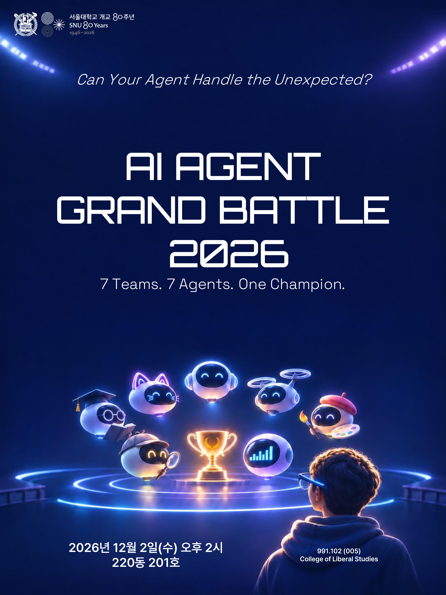
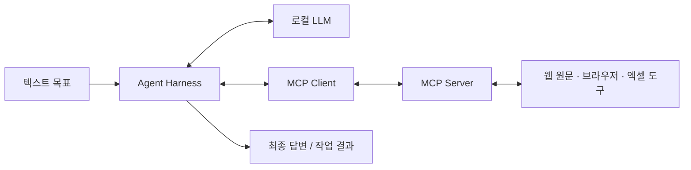

<div align="center">

# AI AGENT GRAND BATTLE 2026

### Can Your Agent Handle the Unexpected?

**7 Teams. 7 Agents. One Champion.**

서울대학교 · 주제탐구세미나2 · Final Project

**2026. 12. 02. (수) 14:00 KST · 220동 201호**

[룰북](docs/RULEBOOK.md) · [시작하기](#시작하기) · [코드 안내](docs/CODE_GUIDE.md) · [리더보드](leaderboard/README.md) · [공지](docs/ANNOUNCEMENTS.md)



</div>

## Overview

처음 보는 문제와 불확실한 상황에 대응하는 AI Agent 시스템을 만듭니다. 텍스트로 받은 목표를 이해하고, 필요한 도구를 선택·실행하며, 관찰한 결과를 바탕으로 답하거나 작업을 완료하는 것이 목표입니다.

이 저장소는 대회 규정, 수업 실습 코드, MCP 기반 기본 코드와 결과 공개 공간을 제공합니다. **현재 대회 전이며 리더보드의 팀·순위·성적은 공란입니다.** 포스터의 12월 2일 행사는 결과 발표일이며, 실제 미션 수행 일정은 아래와 같습니다.

## 일정

| 항목 | 일정 (한국시간) | 안내 |
|---|---|---|
| 데이터 제출 관련 기존 공지 | 11월 20일(금)까지 제출 / 11월 21일(토) eTL 공개 예정 | 과거 공지 기록. 최신 로컬 데이터·RAG 금지가 우선 적용됨 |
| 팀별 코드 제출 | 11월 25일(수) 자정 | 원문 표기. 정확한 마감 시각·제출 경로는 eTL 확인 |
| 실제 미션 수행 | 11월 30일(월)까지 | 연구실 방문, TA 사전 설치 및 실행, 환경설정 맞춤 허용 |
| 결과 발표 | 12월 2일(수) 오후 2시 | 220동 201호, 팀당 10분 발표 |

## 핵심 규정

- **로컬 모델만 사용합니다.** ChatGPT·Claude·Gemini 등 온라인 모델의 API 사용은 금지됩니다. 제공 서버의 로컬 LLM API는 온라인 상용 모델 API와 구분합니다.
- 공통 제공 모델은 공지 표기 기준 **Qwen3.8-27B**입니다. 이보다 큰 모델은 사용할 수 없습니다. 대체 모델은 **27B 미만**을 사용하고, 다른 27B 모델은 운영진에 확인하세요. 공지의 “27B 이상” 문구와 제공 모델 사이의 경계 문제는 [룰북](docs/RULEBOOK.md#모델-규모)에서 설명합니다.
- MoE는 active 파라미터가 아닌 **전체 파라미터 수**를 기준으로 합니다.
- **RAG와 로컬 데이터 사용은 금지됩니다.** 기존 데이터 제출 공지를 허용 예외로 해석하지 않습니다.
- Google 검색 등으로 **Gemini 같은 외부 AI가 생성한 답변을 가져와 사용하는 우회도 금지**됩니다. 일반 웹 원문 조회와 외부 AI 답변 대행은 구분합니다.
- 팀별 제출 문제와 히든 미션으로 평가합니다. **해결 문제 수 내림차순 → 동률이면 수행 시간 오름차순**으로 우승을 정합니다.

최신 제한과 원문 출처, 미확정 항목은 [룰북](docs/RULEBOOK.md)과 [공지](docs/ANNOUNCEMENTS.md)를 확인하세요.

## 시스템 구성



| 구성 | 위치 | 배우는 내용 |
|---|---|---|
| Week 3 · Harness | [labs/week3_agent_harness](labs/week3_agent_harness/README.md) | 기획자 → 예산 담당 → 검토자, 역할별 모델, 도구 입력 검사, shared board, 반복·종료 제어 |
| Week 4 · MCP | [labs/week4_mcp](labs/week4_mcp/README.md) | initialize → tools/list → tools/call, MCP 서버 연결, 웹·위키백과·엑셀 |
| 기본 코드 | [starter](starter/README.md) | Week 4 기반 환경변수 설정, 도구 이름 충돌 방지, 오류·종료 처리 |

실습의 간식 표와 replay는 수업을 재현하기 위한 예제입니다. 대회용 데이터 허용을 뜻하지 않으며, replay 결과는 모델 성능이나 대회 성적으로 사용하지 않습니다.

## 시작하기

Python **3.10 이상**을 사용합니다. 아래 명령은 저장소 루트에서 실행합니다.

```bash
python3 -m venv .venv
source .venv/bin/activate
python -m pip install -r requirements.txt

# 개발용 로컬 Ollama를 실행한 상태에서
ollama pull qwen3-vl:2b-instruct
python starter/agent.py --tools
python starter/agent.py "위키백과에서 서울대학교를 찾아 두 문장으로 알려줘"
```

Windows PowerShell에서는 `py -m venv .venv`와 `.\.venv\Scripts\Activate.ps1`을 사용합니다. 가상환경 활성화가 제한된 경우 `.\.venv\Scripts\python.exe`로 직접 실행하세요.

기본 모델 `qwen3-vl:2b-instruct`는 첨부 강의의 **실습용 모델**입니다. 공통 제공 모델의 실제 API 모델 ID를 대신하는 이름이 아닙니다. 제공 서버 키는 **eTL 8주차 자료**에서 확인하세요. 서버의 주소·프로토콜·모델 ID는 공개 자료에 없으므로 임의로 만들지 않았습니다. 연결 설정은 [starter 안내](starter/README.md#제공-서버-연결)를 참고하세요.

Ollama 없이 Week 3 구조와 정해진 응답을 확인하려면:

```bash
cd labs/week3_agent_harness
python run_lab.py --step inspect
python run_lab.py --step cases --mode replay
python run_lab.py --step report --mode replay
```

## Mission

각 팀은 **자신의 시스템은 풀 수 있지만 다른 팀은 풀기 어려울 것으로 예상하는 문제 1개**를 제출합니다. 팀별 문제와 TA 히든 미션으로 평가하며, TA 출제 문제는 상·중·하 각 1문제입니다. 아래 공지 예시는 중·하 수준이며 최종 출제 문제는 아닙니다.

| 예시 | 필요한 작업 |
|---|---|
| 제공 가계부 Excel에서 2026년 9월 교통비 총액 계산 | 주어진 표 읽기, 월·항목 필터, 합계 계산 |
| 한국시간 오후 2시에 지정 주소로 “미션 수행합니다.” 메일 발송 | 시간대·시각 처리, 발송 실행 |
| 사진 속 박물관에 연예인 A씨 가족이 10월 25일 방문할 때 입장료 계산 | 이미지 식별, 웹 원문 확인, 가족 구성·요금 조건 계산 |

기본 코드는 웹·위키백과·엑셀 생성 도구를 제공합니다. **메일 예약·발송, 이미지 인식, 기존 Excel 읽기 기능은 구현되어 있지 않으므로** 각 팀이 필요한 도구를 추가해야 합니다. 평가 중 제공되는 문제 파일의 입력 범위와 로컬 데이터 금지의 세부 경계는 운영진 안내를 따릅니다.

## Leaderboard

대회 전 · 결과 미공개

<!-- LEADERBOARD:START -->
| 순위 | 팀명 | 해결 문제 수 | 수행 시간 | 발표 / 시연 |
|:---:|---|:---:|:---:|---|
|  |  |  |  |  |
|  |  |  |  |  |
|  |  |  |  |  |
|  |  |  |  |  |
|  |  |  |  |  |
|  |  |  |  |  |
|  |  |  |  |  |
<!-- LEADERBOARD:END -->

[상세 리더보드와 대회 후 갱신 방법](leaderboard/README.md). 실제 성적은 운영진 검수 후 입력합니다.

## 저장소 구조

```text
.
├── README.md
├── assets/poster.jpg
├── docs/                 # 룰북 · 공지 · 코드 안내 · 제출 안내
├── materials/            # 첨부 PDF 3종
├── labs/
│   ├── week3_agent_harness/
│   └── week4_mcp/
├── starter/              # MCP 기본 코드
├── leaderboard/          # 공란 리더보드 · 결과 CSV
├── scripts/              # 리더보드 생성 · 저장소 점검
└── tests/                # 기본 코드 동작 점검
```

## 자료와 참고

- [Final Project 안내](materials/final-project.pdf)
- [Week 3 · Agent Harnessing](materials/week3-agent-harnessing.pdf)
- [Week 4 · MCP](materials/week4-mcp.pdf)
- [공지 정리](docs/ANNOUNCEMENTS.md) · [제출 안내](docs/SUBMISSION.md) · [코드 출처와 변경 내역](docs/SOURCES.md)

README의 개요 → 환경 설정 → 모듈 설명 → 미션 → 결과 구조는 [CRAIP 2024](https://github.com/Taekmino/craip)와 [make_ai_robot 2025](https://github.com/kyungrokrho/make_ai_robot)를 참고했습니다. 해당 로봇 대회의 규정·코드·성적은 가져오지 않았습니다.
